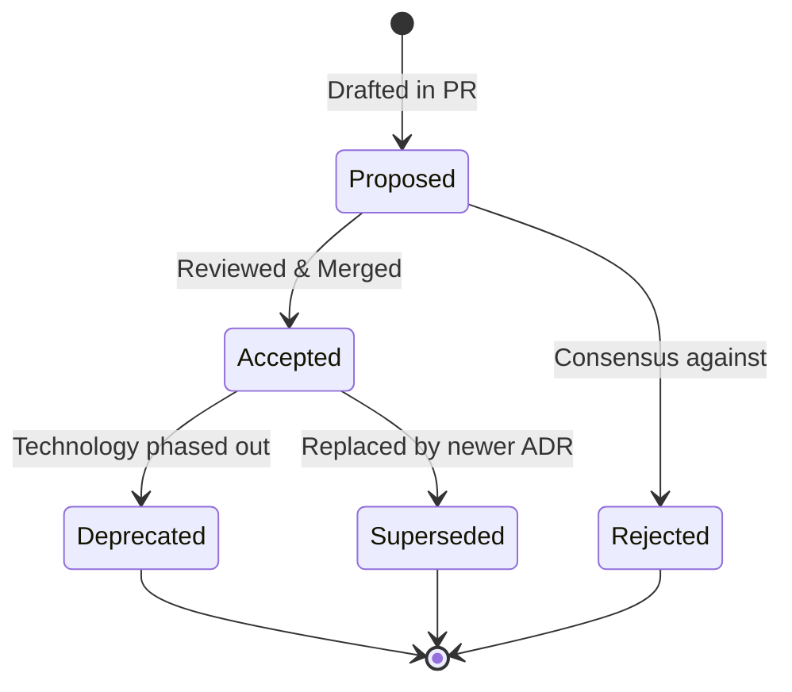

# Architecture Decision Records (ADR) Handbook

An **Architecture Decision Record (ADR)** captures a single architecturally significant decision, along with its context and consequences. ADRs provide an immutable audit trail of how and why a system evolved over time.

---

## 1. When Should an ADR Be Written?

Write an ADR whenever a technical decision has a **high cost of reversal**. 

### Trigger Scenarios:
- Changing foundational language, framework, or runtime (e.g., migrating from Express to Fastify, or adopting Next.js App Router).
- Selecting a primary database, cache engine, or message broker (e.g., PostgreSQL vs. MongoDB, Redis vs. RabbitMQ vs. BullMQ).
- Adopting a repository architecture (e.g., Monorepo with Turborepo vs. Polyrepo).
- Designing authentication or tenancy boundaries (e.g., Multi-Tenant schema isolation vs. Row-Level Security).
- Deprecating a major API version or communication protocol (e.g., REST to gRPC / GraphQL).

### When NOT to Write an ADR:
- Routine bug fixes or everyday code refactoring.
- Adopting a minor utility library (e.g., `lodash` vs. native functions).
- Styling or UI layout tweaks.

---

## 2. Anatomy of a Senior ADR

A senior ADR is structured according to the Nygard / MADR standard:

1. **Title & Number**: Sequential identifier (`ADR-001-microservices-monorepo-architecture.md`).
2. **Metadata**:
   - `Status`: `Proposed` | `Accepted` | `Rejected` | `Deprecated` | `Superseded by ADR-XXX`
   - `Date`: ISO timestamp (YYYY-MM-DD).
   - `Author(s)`: Lead engineer(s) or agent persona.
   - `Deciders`: Key stakeholders who reviewed and approved.
3. **Context**:
   - The business problem, current pain points, technical constraints, and requirements.
   - Why can the current architecture not satisfy the requirement?
4. **Decision**:
   - The active choice made in imperative tense: "We will adopt X for Y."
   - Detailed technical implementation plan.
5. **Consequences**:
   - **Positive Impacts**: Expected performance gains, developer velocity, type safety.
   - **Negative Impacts**: Operational complexity, new maintenance burden, learning curve.
   - **Risks & Mitigations**: What could go wrong and how will it be handled?
6. **Alternatives Considered**:
   - Competing options evaluated and specific reasons why they were disqualified.

---

## 3. ADR Lifecycle & Governance

### Golden Rules:
- **Never Edit an Accepted ADR's Decision**: Once merged and deployed, an ADR is an immutable snapshot in time. If requirements change, create a new ADR that explicitly marks the old one as `Superseded by ADR-XXX`.
- **Maintain an Index Table**: Keep a clear index in `docs/adr/README.md` listing all ADRs by number, title, date, and status.
