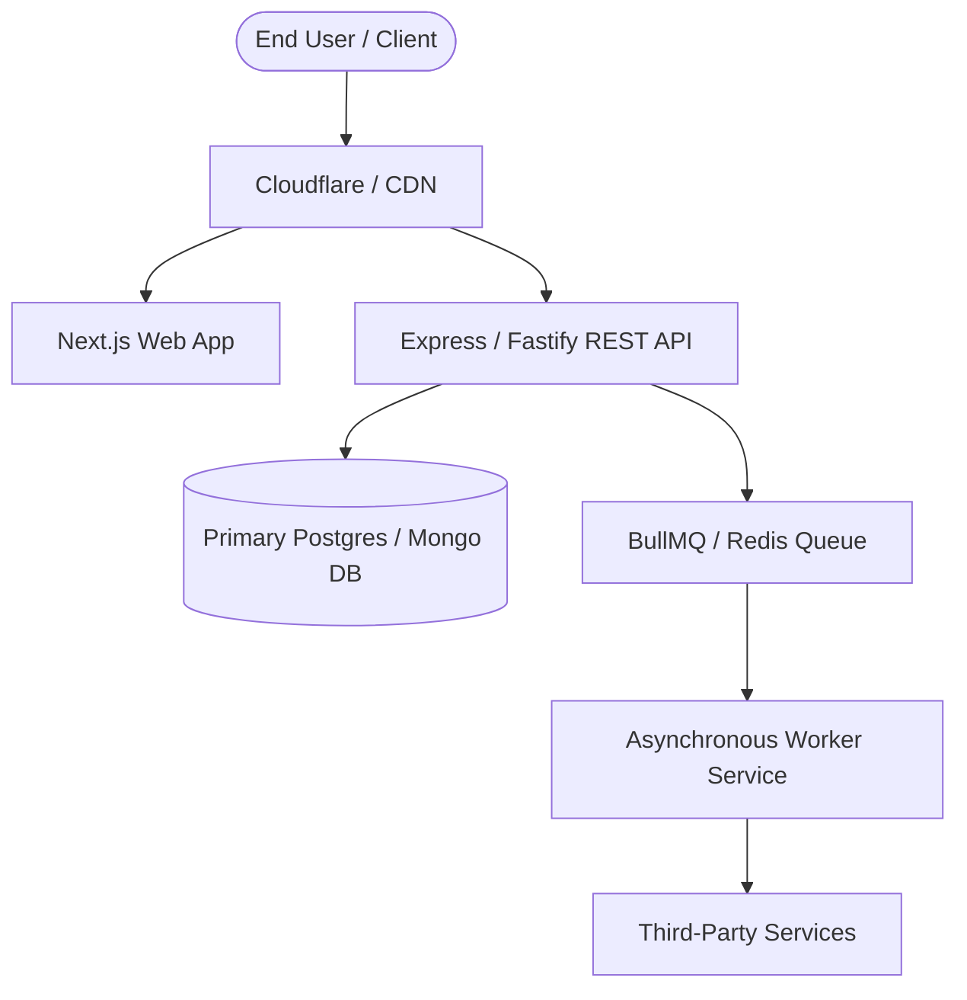

# {{PROJECT_NAME}}

[](./.github/workflows/ci.yml)
[](./LICENSE)
[](tsconfig.json)
[](https://www.conventionalcommits.org/)

{{PROJECT_DESCRIPTION}}

---

## ⚡ Quick Start

Boot the complete local development environment in 3 commands:

```bash
# 1. Clone the repository
git clone https://github.com/{{ORG_NAME}}/{{REPO_NAME}}.git
cd {{REPO_NAME}}

# 2. Configure environment variables
cp .env.example .env

# 3. Install dependencies and start local servers
npm install
npm run dev
```

Visit the local instance:
- **Web Client**: [http://localhost:3000](http://localhost:3000)
- **API Server**: [http://localhost:4000](http://localhost:4000)
- **API Documentation**: [http://localhost:4000/docs](http://localhost:4000/docs)

---

## 🏗️ System Architecture



For comprehensive deep-dives into our system topology, data models, and access control:
- 📐 [System Design & Component Topology](./docs/architecture/system-design.md)
- 🗄️ [Data Models & Schema ERD](./docs/architecture/data-model.md)
- 🔒 [Security & RBAC Matrix](./docs/architecture/security-and-rbac.md)
- 📜 [Architecture Decision Records (ADRs)](./docs/adr/README.md)

---

## 🛠️ Tech Stack & Workspace Structure

```
├── apps/
│   ├── web/          # Frontend Web Application (Next.js / React)
│   ├── server/       # Core REST & WebSocket API Gateway
│   └── worker/       # Asynchronous background job consumers (BullMQ)
├── packages/
│   ├── ui/           # Shared design system components
│   └── types/        # Shared TypeScript data models and DTOs
└── docs/             # Technical architecture, ADRs, and runbooks
```

---

## ⚙️ Environment Configuration

Copy `.env.example` to `.env` before running the stack.

| Variable | Description | Required | Default |
|---|---|---|---|
| `NODE_ENV` | Application runtime environment (`development`, `production`) | Yes | `development` |
| `PORT` | API Server listening port | No | `4000` |
| `DATABASE_URL` | Primary database connection string | Yes | - |
| `REDIS_URL` | Redis instance for caching and job queues | Yes | `redis://localhost:6379` |
| `JWT_SECRET` | Cryptographic secret for signing auth tokens | Yes | - |

> [!WARNING]
> Never commit actual credentials or secrets to git. Staging `.env` files will fail pre-commit gates.

---

## 🧪 Testing & Verification

Run our full verification suite locally:

```bash
# Run unit and integration tests
npm test

# Run static type checks across all workspaces
npm run typecheck

# Run linter and formatting rules
npm run lint

# Verify full production build passes
npm run build
```

---

## 🤝 Contributing

We welcome contributions from the community and internal engineering teams.
Please review our [Contributing Guidelines](./CONTRIBUTING.md) and [Git Engineering Standards](./docs/git-standards.md) prior to submitting a pull request.

---

## 🛡️ Security

To report security vulnerabilities, review our [Security Policy](./SECURITY.md). We adhere to responsible disclosure SLAs.

---

## 📄 License

This repository is licensed under the [MIT License](./LICENSE).
